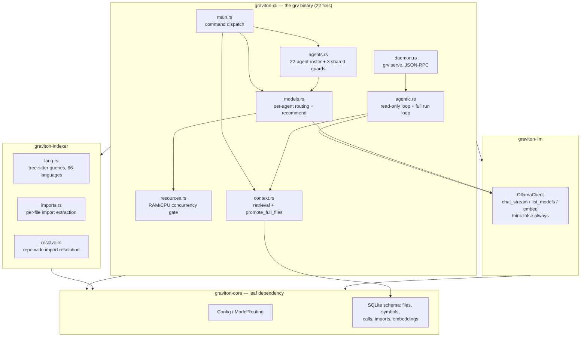
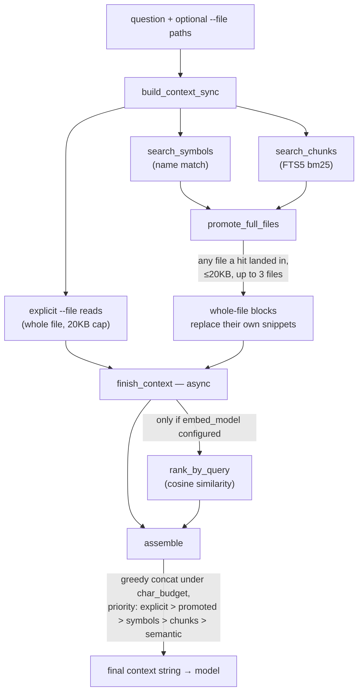
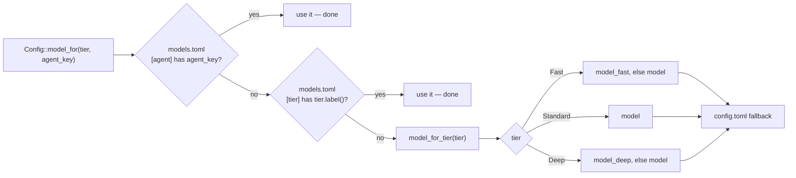
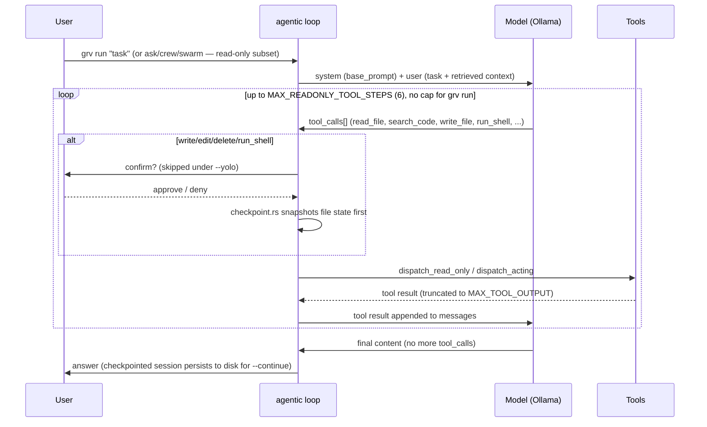

# Architecture

This document explains *why* the code is shaped the way it is — the
constraints that forced each decision, the dead ends that got ruled out,
and the failures (several caught live, against real production code,
not toy examples) that changed the design mid-course. If a design choice
below looks unusual, assume it's a scar from one of those failures
before assuming it's an oversight.

## The constraint everything else follows from

This is built for a machine with no datacenter GPU — often no GPU doing
any of the work at all — and a model in the 4B–9B parameter range,
quantized. Concretely, the reference machine for most of this project's
testing: 12 CPU threads, ~15.5GB RAM, a 4GB-VRAM GPU too small to hold
even a quantized 7B model's weights plus KV cache (and, for long
stretches of this project's own development, not even configured to use
that GPU at all — CPU-only inference the whole time). Measured real
throughput on that hardware, no padding: ~24-26 tokens/s prompt
processing, ~3.5-4 tokens/s generation, for a 4B model.

Every other section follows from that number. A 7-tool-call agentic loop
against a real codebase question, on this hardware, took over 30
minutes end to end in testing — not because anything was broken, but
because that's what CPU inference at this model size actually costs. The
engine's job is to make every one of those tokens count: never ask the
model to do something deterministic code can do faster and more
reliably, never show it more context than the question needs, never let
a resource-planning mistake turn a slow machine into a crashed one.

## Component breakdown

Four crates, 15 183 lines of Rust:



- **`graviton-core`** (`crates/core`) — `Config`/`ModelRouting` (load/
  save/resolve), the SQLite schema (`open_db`), and the handful of types
  (`Symbol`, `FileRecord`, `ModelTier`) every other crate depends on. No
  tree-sitter, no network, no CLI — kept a leaf dependency on purpose so
  the data model can be inspected/tested without pulling in parsing or
  I/O.
- **`graviton-indexer`** (`crates/indexer`) — `lang.rs` (tree-sitter
  queries per language), `imports.rs` (per-file import-statement
  extraction), `resolve.rs` (repo-wide import resolution, a second
  pass once every file's path is known). The only crate that links
  against the 50+ C grammar crates.
- **`graviton-llm`** (`crates/llm`) — the Ollama HTTP client:
  `chat_stream` (streaming, tool-calling, "thinking" disabled by
  default), `list_models`/`model_sizes_mb` (`/api/tags`), `embed`
  (`/api/embeddings`). No business logic — every agent-specific decision
  lives in `crates/cli`.
- **`graviton-cli`** (`crates/cli`, 22 files) — everything else: the
  `grv` binary, the agent roster and its system prompts (`agents.rs`),
  context assembly (`context.rs`), the agentic tool loop (`agentic.rs`),
  resource/concurrency management (`resources.rs`), per-agent model
  routing (`models.rs`), the daemon (`daemon.rs`), and more.

### Why Rust over C/C++ or a scripting language

Three reasons, all load-bearing given the hardware constraint above, not
stylistic preference: tree-sitter's C grammars need an FFI story that
isn't a GC pause away from a crash; the resource-management code
(`resources.rs`) is exactly the kind of "estimate what else is running
and don't oversubscribe it" logic that benefits from no runtime
overhead competing for the same CPU the model needs; and the whole
project's premise is "spend cycles on deterministic work instead of the
model" — writing that deterministic work in a language with GC pauses
or an interpreter loop would undercut the premise.

### Storage: SQLite + FTS5, not a vector DB, not tantivy

One file per repo (`.graviton/index.db`), zero external services, zero
network calls for retrieval. FTS5 gives real bm25 ranking without a
server. Embeddings (opt-in, see below) are stored as BLOBs in their own
table rather than a dedicated vector index — this project's repo sizes
(thousands, not millions, of chunks) don't need an ANN structure for
*storage*; the ANN index that exists (`ann.rs`) is specifically for
*query-time* speed once embeddings are turned on, built fresh in memory
per session rather than persisted, because rebuilding from already-
persisted vectors is cheap and staying correct-by-construction (no
on-disk index format to keep in sync with the embeddings table) was
worth more than the rebuild cost.

### Schema

```
files(id, path, lang, size, mtime, hash)
symbols(id, file_id, kind, name, start_line, end_line, parent)
calls(id, file_id, caller_symbol_id, callee_name, line)
imports(id, file_id, raw_path, imported_name, is_wildcard, module_prefix, line)
import_resolutions(import_id, file_id)   -- many-to-many: one import can resolve to several files (a Go package import)
content_fts(path, start_line, end_line, kind, name, body)  -- virtual FTS5 table
embeddings(chunk_id, model, dims, vector)                   -- opt-in
tool_runs(id, tool, args, ran_at, exit_code, output)        -- grv tool run/ingest history
```

`imports`/`import_resolutions` are separate tables on purpose:
extraction (one file's own content) and resolution (needs every file's
final path, so it's a second pass over the whole repo) are genuinely
different operations with different inputs, and keeping them as
different tables means a partial re-index never leaves resolution data
inconsistent with extraction data for files that didn't change.

### Symbol extraction is best-effort; search is never gated on it

Every file is chunked and FTS-indexed regardless of whether its
language has a tree-sitter grammar wired up — `grv search`/`grv ask`
work on any text file. `grv symbol` additionally needs a `def` query for
that language; 13 of the 66 recognized languages (CSS, JSON, YAML, ...)
don't have one and never will (no "definition" concept to extract), and
2 more (Svelte, Vue) have a grammar that parses but can't support one
without a second, injection-based parse of an embedded-JS `<script>`
block their own grammar exposes as opaque text.

### Call graph (`grv callers`/`grv callees`, `callgraph.rs`)

Deliberately name-based, not type-resolved: `grv callers run` matches
every call site literally named `run(...)`, whichever `run` it actually
is. Full type resolution (which overload, which trait impl) is the kind
of engineering effort a language server spends its entire existence on
— out of scope here by design, not by oversight. What closes *most* of
the gap without attempting that: every hit carries a `ResolutionHint` —

- `SameFile` — a definition named the same thing exists in the same file
- `UniqueElsewhere` — exactly one definition exists anywhere in the index
- `Ambiguous` — more than one candidate, each one listed (file, symbol,
  how it was reached) so a human/model can pick, never a silent guess
- `Unresolved` — nothing indexed by that name

48 of the 66 languages have call-graph coverage (everything with a `def`
query except GraphQL/Protobuf, which have no function-call concept at
all to extract).

### Import resolution (`imports.rs` extraction, `resolve.rs` resolution)

Two genuinely different problems, solved with two different techniques
on purpose:

- **Extraction** is a bespoke AST walker per language, not the flat
  single-capture query style `def`/`call` queries use — import syntax
  nests and aliases too much for one capture pattern (`use a::{b::{c, d
  as e}, f::*}` is a recursive tree of brace lists, renames, and glob
  markers in one statement).
- **Resolution** runs once per repo, after every file's path is known,
  because a relative import can only resolve against the *final* set of
  files, not whatever's indexed so far. Per-language logic: Rust's
  crate/mod-tree and `self`/`super`/`crate` semantics, Python's package
  tree, JS/TS relative-path resolution with extension inference, Go's
  whole-package-directory imports, Java's source-root convention, and
  so on for the 54 languages that have it.

An import that doesn't resolve (an external dependency, the stdlib, or a
shape this heuristic doesn't cover) is reported as exactly that —
`Unresolved`, a real "don't know," never a wrong guess dressed up as an
answer. The one deliberate non-resolution: WGSL's `#import a::b` names
an arbitrarily-registered shader module, not a file-per-module
convention — there's nothing reliable to resolve against, and guessing
off a same-named file anywhere in the repo would be exactly the fuzzy
match every other resolver here is built to never do.

### Context assembly (`context.rs`)



**`promote_full_files` exists because of a live failure, not a
hypothesis.** A security-agent question got a chunk hit on a
controller's one `@Roles` decorator; the stricter, per-operation check
in a different file never got retrieved; the model concluded the weaker
check was the only one and both invented a reimplementation of the
missing one *and* fabricated an exploit scenario the real code's control
flow ruled out. A prompt instruction telling agents to `read_file`
before asserting didn't reliably fix it — logged zero tool calls on a
retry of the same question; the model just answered from the incomplete
snippet anyway. The fix that actually worked is mechanical, not
behavioral: for every distinct file any symbol/chunk hit landed in,
replace *all* of that file's snippets with the file in full (bounded to
~20KB, the same cap `--file` uses, so a huge file search matched for a
real reason isn't replaced by a truncated prefix that might cut past the
relevant part), up to 3 distinct files, in hit-rank order. The model
sees the real mechanism whether or not it bothers to ask for more —
because testing proved it often doesn't bother.

`assemble` is deliberately greedy and simple: concatenate blocks in
priority order (explicit `--file` > promoted full files > symbol hits >
FTS chunks > semantic hits), skip any block that would exceed the char
budget, keep going — not length-optimal (a big block that doesn't fit
might get skipped while a smaller, lower-priority one after it does
fit), but predictable and cheap, which matters more than optimality for
a budget this tight.

### Ollama client (`crates/llm`)

`chat_stream` sends `think: false` on every request — not a
micro-optimization, a bug fix. A model with "thinking" on by default
(confirmed on one in testing) streams its reasoning in a separate
`message.thinking` API field; the client didn't parse that field at all
when this was discovered, so a turn that spent its entire token budget
reasoning completed with `done: true`, non-empty token count, zero
truncation, and *nothing* in `message.content` — no error, no partial
text, just silence. No agent here consumes a reasoning trace (only the
final answer or a tool call), so disabling it outright is strictly
better than parsing it and discarding it. `message.thinking` is now
parsed into `ChatResult::thinking` anyway, unused by any caller today,
purely so a model that streams one despite the request flag doesn't
disappear into a field serde doesn't know exists.

## Model tiers and per-agent routing

`ModelTier` (`Fast`/`Standard`/`Deep`) is the coarse axis: `grv config
--model-fast/--model-deep` lets `swarm`/`mission` spread work across
differently-sized resident models instead of one model for everything.
`ModelRouting` (`~/.config/graviton/models.toml`, `models.rs`) is the
fine axis layered on top: an `[agent]` override (keyed by agent key, not
tier) beats a `[tier]` override, which beats the three-slot fallback —
`Config::model_for(tier, agent_key)` is the one function every call site
in the codebase goes through to resolve a model, so the two axes can
never silently disagree between entry points.



That finer axis exists because the coarse one hit a real wall: two
agents sharing `ModelTier::Deep` — `architect` (software design) and
`reaper`/`binexp`/`cryptographer`/`quantumcrypto` (exploit dev / crypto
review) — have no reason to want the same model, and a `models.toml`
entry per agent key doesn't need a new `ModelTier` enum variant (and a
recompile) every time the grouping needs to change.

### `grv models recommend` — a classifier, not a guess

Given what's actually pulled in Ollama (`/api/tags`, with real sizes)
and this machine's *available* RAM right now, it:

1. Classifies every model by tag pattern — `coder`/`code` + a parsed
   parameter count from the tag → fast or standard; `deephat`/`cyber`/
   `pentest` → flagged security-tagged; `obliterat`/`abliterat`/
   `uncensored` → flagged uncensored, for authorized-engagement use;
   `vl`/`vision`/`llava` (several naming conventions checked, including
   the no-separator form `qwen2.5vl:7b` a real pulled model actually
   used — caught live when the first version of this check missed it)
   → vision, left unassigned since no text agent calls on one;
   `:cloud` → left unassigned, not local.
2. Skips anything whose size exceeds 70% of *available* RAM — the same
   number `resources.rs`'s concurrency math uses, kept in sync rather
   than re-derived, because it encodes the same "don't crash the
   machine" judgment call.
3. Picks the smallest fast-classified model for `tier.fast`, the
   largest standard-classified for `tier.standard`, the largest
   otherwise-unclassified generalist for `tier.deep` (distinct from the
   code-tuned standard model on purpose — broader reasoning is more the
   point for design work than code completion).
4. **Does not auto-assign the security-tagged or uncensored picks to any
   agent**, even though an earlier version of this project did. Two live
   findings reversed that: the uncensored pick's chat template
   hard-crashed Ollama (`HTTP 500`, `Jinja Exception: No user query
   found in messages`) the instant a tool-result turn followed a tool
   call — `ollama show --template` confirmed why: the template that GGUF
   import carries is built for a vision model's multi-step-tool macros,
   not a generic tool-result turn at all. The security-tagged pick
   didn't crash, but its tool calls never registered as structured
   `tool_calls` either — a JSON blob showed up as plain `content`
   instead, meaning Ollama's template for it doesn't signal
   function-calling at all. Every agent here reaches the model through
   the same tool loop specifically because that's what makes an answer
   grounded instead of guessed; a model that silently can't call a tool,
   or hard-crashes the instant it tries, is a worse default than a
   generalist that reliably can — even though, in a one-shot test with
   no tool calls at all, the uncensored model was measurably *more*
   careful than the alternatives (correctly scoped a risk to its actual
   precondition, quoted the target code's own doc comment verbatim,
   produced none of the checklist-pattern hallucinations the others did).
   Both stay recognized and are printed, flagged, available via `grv
   models set` for a workflow that mainly feeds complete context through
   `--file` and doesn't lean on the tool loop.

## Resource-aware concurrency (`resources.rs`)

```rust
let budget = cap.available_ram_mb as f64 * RAM_SAFETY_FRACTION;  // 0.7
```

That line used to read `cap.total_ram_mb`. **This was a real, live bug,
not a hypothetical one**: a 3-agent `swarm` sized itself to "~3/5
distinct models resident" against a 15.6GB *total*-RAM budget while only
~9.4GB was actually *available* — the rest already held by the desktop,
browser, and IDE running alongside it, on the exact machine this project
targets. It loaded two ~4.5GB models concurrently; `ollama serve`
stopped responding to all three in-flight requests partway through, no
OOM-killer entry in `dmesg`, just silent resource starvation. The
module's own doc comment said "vs. total system memory" at the time —
the bug was in the design intent, not a one-line typo; `Capacity`
already sampled `available_ram_mb` every tick for exactly this purpose,
and the arithmetic simply never used it. One-line fix, verified against
the exact conditions that crashed: `grv status` now reports ~1/5
distinct models resident at a similar available-RAM figure that used to
report ~3/5.

Two constraints, kept conceptually separate because conflating them
would under- or over-estimate one of them:

- **RAM** bounds how many *distinct* models can be resident at all —
  estimated from real `/api/tags` sizes against available memory, not
  Ollama's own model residency/eviction (`resources.rs` doesn't
  second-guess that, only estimates ahead of it).
- **CPU** bounds how fast concurrent generations run *once* resident —
  on a 6C/12T machine with no real GPU offload, three agents generating
  at once split the same cores three ways; a net win for the batch's
  wall-clock, a real slowdown for any one agent's own stream. `grv
  swarm` states that trade-off up front rather than hiding it.

`LiveScheduler` re-samples `Capacity::detect()` every 3 seconds for the
whole duration of a `swarm`/`mission` run — model sizes are fetched once
(they don't change mid-run), capacity is cheap and re-sampled
continuously, so a long `mission` that spawns agents recursively and
unpredictably never holds more concurrent calls than the machine can
actually take at that moment, and grows back into headroom that frees up
as earlier agents finish.

## The agent system

### Every agent's prompt goes through one function

`AgentSpec::base_prompt()` = `system_prompt` + three shared guards,
appended in order, used at *every* entry point that sends a system
message to the model (`ask`/`investigate`, `crew`/`review`'s pipeline,
`swarm`, `mission`'s leaves, `run`'s full tool loop, the `serve`
daemon's `prepare_ask`/`prepare_review`) — one function instead of 22
separate prompt strings each needing the same fix independently, and a
guard that can't silently be present at one entry point and missing at
another.

**`CONTEXT_RELEVANCE_GUARD`** — retrieved context is whatever ranked
highest, not guaranteed relevant, and a question isn't always about the
codebase at all. Added after `grv ask "say hello in French"` pulled back
unrelated Rust indexing code and the model concluded it couldn't answer
a greeting.

**`VERIFY_BEFORE_ASSERTING_GUARD`** — before a definitive claim about
behavior, `read_file` the specific file that would prove it, even when a
snippet looks sufficient; never propose a fix without confirming via
`read_file` that it doesn't already exist elsewhere in the path.

**`NO_FINDING_IS_A_VALID_ANSWER_GUARD`** — state the verdict first, in
direct language; address every named mechanism in a multi-part question,
not just the first one that pattern-matches; "already correctly
handled, no fix needed" is a complete, successful answer, and
manufacturing a change to something already sound is worse than saying
so plainly.

The second and third guards exist because the first wasn't enough on its
own, and testing kept finding new, more specific ways a confident-
sounding wrong answer could still get through even with all three in
place (see the README's honest accounting of what still gets past them).
Several agents' own prompts additionally enumerate concrete things to
check for (CRYPTOGRAPHER's "weak primitives... ECB mode...",
SENTINEL's "injection, auth/authz flaws, ..."); those are now explicitly
worded as a list to rule in or out, not a quota to fill, after a model
reported "Use of ECB Mode" against code that does no block-cipher
encryption anywhere, because the phrase existed in its own prompt as an
example.

### Per-agent retrieval, everywhere — a bounded tool loop, not one fixed pass

`ask`/`investigate`/`crew`/`review`/`swarm` all run
`agentic::run_read_only_loop` — up to `MAX_READONLY_TOOL_STEPS` (6) tool
round-trips (`read_file`, `list_dir`, `search_code`, `semantic_search`,
`web_search`, `web_fetch`, `git_status`/`diff`/`log`) before a final,
no-tools-offered call forces a text answer instead of silently returning
nothing. `grv run`/`grv mission` get the superset with write/edit/
delete/shell/browser tools, checkpointed and confirmed (see below).
Shared code (`read_only_tool_defs`) between the read-only loop and the
leaves of `grv mission`'s tree, specifically so a mission leaf's
retrieval can't drift from what `ask` offers.

A loop, not one fixed retrieval pass, means retrieval can expand mid-
answer when the initial pass turns out insufficient — in principle. In
practice, testing found a 7B-class local model frequently just doesn't
bother calling the extra tool even when told to, which is the entire
reason `promote_full_files` (a mechanical, not behavioral, fix) exists
at all — see above.

## The agentic loop (`grv run`, `agentic.rs`)



### Tools

Everything the read-only loop has, plus: `write_file`/`edit_file`/
`delete_file`, `run_shell`, `run_tests` (project-detected: cargo/npm/
pytest/go test/...), real git (`git_status`/`diff`/`log`/`commit`, not
simulated), `update_plan` (visible, persisted progress), `ask_user`
(a fixed-option clarifying question when a task is genuinely ambiguous
— not for yes/no confirmations, that's what the write/shell confirm
already covers), and `browser_navigate`/`browser_eval`/... when
`--browser` is set (headless Chromium via `chromiumoxide`).

### Safety model: confirm by default, checkpoint always

Every write/edit/delete/shell call is confirmed with the user before it
happens, unless `--yolo`. Checkpointing (`checkpoint.rs`) is
unconditional regardless of `--yolo` — it snapshots file state before
every write/edit/delete so `grv rollback` can undo it, entirely or back
to one step. Scope is deliberately narrow: this is a checkpoint for the
agent's *file* edits, not a full system snapshot — a `run_shell` call
might touch anything in or out of the repo, which is exactly why
`run_shell` gets a pre-execution confirmation instead of a post-hoc
undo; there's no generic way to snapshot "whatever an arbitrary shell
command might do."

Fine-grained permission rules (`permissions.rs`,
`.graviton/permissions.toml`) layer *underneath* that default rather
than replacing it: a `deny` rule blocks a call even under `--yolo`, an
`allow` rule skips confirmation even without it, checked in file order,
first match wins, a small hand-rolled glob (`*` only) against each
call's one "primary" argument. A call that matches no rule falls
through to exactly the behavior GRAVITON already had — this is additive,
never a parallel permission system that could disagree with the
default.

### Session resumability

The conversation transcript, plan, and checkpoint history persist to
disk per session. `grv run --continue` (optionally `--session <id>`)
restores all three and picks up a multi-hour task exactly where it left
off — including after a crash, not just a clean exit. `grv mission`'s
own recursive tree gets the same treatment
(`checkpoint::MissionCheckpoint`, `grv mission --continue`), since a
mission can spawn arbitrarily many subtasks and losing that tree to a
restart would be a much bigger loss than losing one flat conversation.

### One loop, two front ends (`run_io.rs`)

The confirm/output logic is behind a trait (`RunIo`), not hardcoded to
stdout — the CLI implements it with terminal prompts, `daemon.rs`
implements it with NDJSON notifications over the socket
(`approval_request`/`approval_response`, `token`, `tool_call`), so `grv
serve` can drive a full `grv run` session (`run_attach`) with the exact
same tool loop and safety model the CLI uses, not a second hand-copied
implementation that could drift.

## `grv serve` — the daemon (`daemon.rs`)

Newline-delimited JSON-RPC 2.0 over a Unix socket at a short,
repo-hashed path under `$XDG_RUNTIME_DIR/grv` (not under the repo
itself — a nested repo path can exceed the ~100-byte Unix socket path
limit, a real failure mode caught and fixed, not a hypothetical one).
`--tcp` adds a TCP listener behind a required, printed token, over TLS.
Methods: `status`, `search`, `symbol`, `callers`, `callees`, `ask`,
`review`, `run_attach` (a full `grv run` session, with
`ask_user`/approval round-trips as notifications), `shutdown`.
Streaming (`ask`/`review` with `"stream": true`) sends `token`
notifications as they generate instead of waiting for the whole answer.
Exists specifically so an editor extension can query the warm index
repeatedly without the cost of opening it fresh — and, for `ask`/
`review`, without re-paying a cold model load — per keystroke.

## Semantic search (opt-in)

`grv config --embed-model <tag>` (an embedding-capable model already
pulled, e.g. `nomic-embed-text`) + `grv embed` computes and stores a
vector per indexed chunk that doesn't have one yet (`semantic.rs`).
`grv search --semantic` ranks by cosine similarity instead of bm25; the
same ranking folds into agent retrieval automatically once embeddings
exist, no separate flag needed there. An in-memory ANN index (`ann.rs`)
built fresh per session, not persisted, keeps query-time ranking fast
without maintaining an on-disk index format that could drift from the
embeddings table — see the storage rationale above. Nothing here changes
default behavior for an install that never sets `--embed-model`.

## Tool execution (`tools.rs`)

A fixed whitelist (`nmap`, `masscan`, `ffuf`, `gobuster`, `sqlmap`,
`hydra`, `john`, ... — `grv tool list` prints the live list) for recon/
security tools `grv tool run` can execute, streaming output live and
indexing it under `tool://<name>#<id>` so `grv ask`/`grv search` can
reason over a scan's actual output afterward. `grv tool ingest` indexes
output captured elsewhere (a Burp export, a tool not on the whitelist)
without running anything. Whitelisting exists because `grv run`'s
`run_shell` already covers "run an arbitrary command" with its own
confirmation step; `grv tool run` is specifically for the common recon
tools worth having indexed output and run-history for, not a second,
broader shell-execution path.

## What's explicitly not built

- **Call-graph type resolution** — knowing exactly which overload/trait
  impl a call targets. `ResolutionHint` closes most of the practical gap
  short of it; closing the rest is language-server-scale effort, not
  attempted.
- **Svelte/Vue symbol extraction** — needs a second, injection-based
  parse of their `<script>` block; their own grammars expose it as
  opaque text with no def query to write against.
- **A reliable way to stop a small *local* model from confidently
  asserting a false positive against already-correct code.** Three real
  prompt-level fixes (see above) reduced how often this happens at the
  3B–9B scale this project targets; none eliminated it. Isolated by
  swapping only the model on an otherwise-identical question: a 31B
  model (`gemma4:31b-cloud`) got the verdict right, cited accurate
  evidence, and investigated a second file on its own where every local
  model tested had not — so this is a model-*capacity* ceiling the
  prompts and guards can't push past on their own, not an architecture
  flaw. `grv models recommend` still never auto-assigns a `:cloud` tag
  (see above) — the fix for a question that needs that accuracy is a
  deliberate, per-agent `grv models set`, not a silent default, because
  it trades this project's core "nothing leaves the machine" property
  for it. On the hardware class this project actually targets, every
  agent's local-model output stays a lead, not a verdict, until a human
  (or `promote_full_files`-style mechanical grounding, the only
  *local* fix that's actually worked so far) confirms it.
